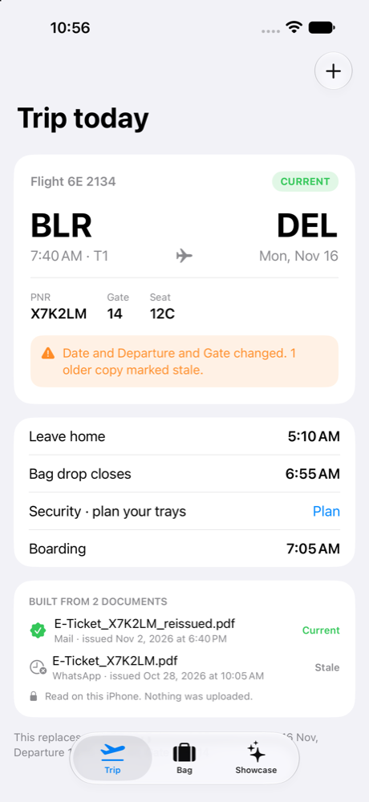
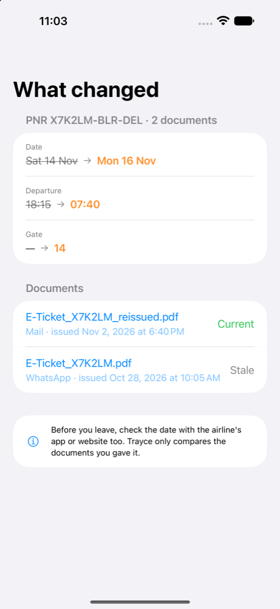
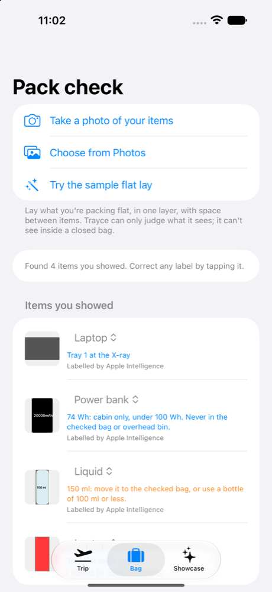
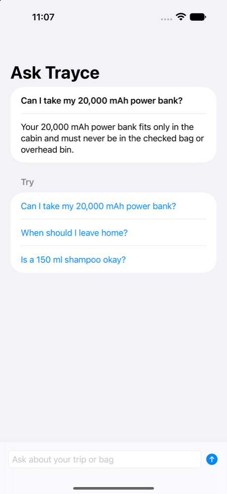
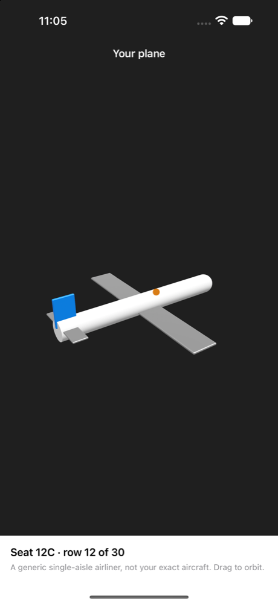
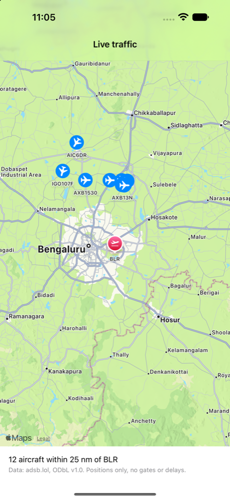
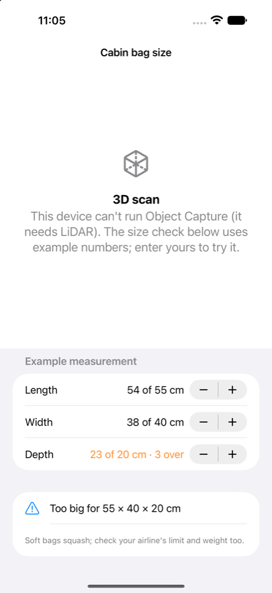
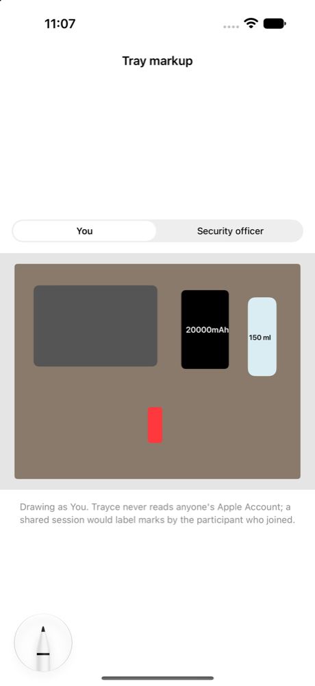

# Trayce

**Your trip, always the latest copy. Your trays, planned before the X-ray.**

Trayce is an open-source iPhone app (iOS 27). It brings together the booking PDFs and screenshots you get from MakeMyTrip, airlines and WhatsApp, works out which copy is current, and plans your security trays from a photo of what you packed. It's built only on Apple frameworks, and everything is read on the device.

> Status: MVP demo, running in the iOS 27 Simulator (screens below, 3 Nov 2026). The camera, boarding barcode reading and the LiDAR scan need a real iPhone.

**Watch it run:** a [21-second demo](docs/demo-2026-11-04/trayce-demo-2026-11-04.mp4) recorded on an iPhone 17 Simulator (iOS 27.2) with the sample trip: trip, what changed, tray plan, plane, Ask, pack check.

| Trip | What changed | Pack check | Ask Trayce |
|---|---|---|---|
|  |  |  |  |

| Your plane | Live traffic | Bag size | Tray markup |
|---|---|---|---|
|  |  |  |  |

## Why it exists

I changed a booking on MakeMyTrip. The PDF I'd been sent on WhatsApp still showed the old date, and I got stuck at the airport. Then at security, trays got re-checked because a cable or power bank went in the wrong place.

| Moment | MakeMyTrip + WhatsApp | Trayce |
|---|---|---|
| Booking changed | The old PDF stays in chat looking just as valid | Same PNR and leg with a newer issue date: the old copy is marked **stale** and the changed fields are shown. Copies without issue dates that disagree are flagged **Check** |
| Many sources | Booking app, airline email, agent's WhatsApp, screenshots | One trip per leg, listing every document behind it, current or stale |
| No signal at the gate | Needs the network or a lot of scrolling | Stored on the device; the airline's own barcode is cropped from its PDF |
| Security | Nothing | Pack check → tray plan → Lock Screen Live Activity |
| Privacy | Documents go through servers | PDFKit, Vision and Foundation Models run on the iPhone |

## What's inside

| Feature | Apple APIs |
|---|---|
| Read any booking | PDFKit `PDFPage.string`, Vision `RecognizeDocumentsRequest`, `DetectBarcodesRequest` |
| Fill a typed booking | A pattern reader first; for layouts it can't read, Foundation Models `@Generable`. Each model field (PNR, flight, airports in order, date and time, issue date) must appear in the text, or the answer is rejected |
| Newest copy wins | `TrayceCore.SupersedeResolver` (pure Swift, unit-tested) |
| Boarding pass data | IATA BCBP parser (`TrayceCore.BCBPParser`) |
| Pack check | Vision `GenerateForegroundInstanceMaskRequest` cut-outs, Foundation Models image `Attachment`, `RecognizeTextRequest` for mAh/Wh/ml, `ClassifyImageRequest` fallback |
| Tray rules | A dated, sourced rule table (`rules-IN.json`). AI never decides what's allowed |
| Lock Screen | ActivityKit Live Activity and Dynamic Island, WidgetKit widgets through an App Group |
| Ask Trayce | `LanguageModelSession` with `Tool`s (`getTrip`, `checkItemRule`): the model phrases, the tools decide |
| Your plane, in miniature | RealityKit `RealityView`, built from primitives (no third-party model) |
| Cabin bag size | Object Capture + `PhotogrammetrySession`, real-world bounds against 55 × 40 × 20 cm |
| Tray markup | PaperKit `PaperMarkupViewController` + PencilKit tool picker |
| Live traffic | [adsb.lol](https://adsb.lol) open data on MapKit (positions only) |

**How the AI is used.** Code decides every fact: PNR, which copy is current, Wh, tray, allowed or not. The on-device model only reads messy documents and phrases answers, and anything it returns is checked by code before it's used.

## Honest limits

- A phone can't see inside a closed bag. Trayce judges only the items you show it.
- Apple has no public flight-status API. Gate, terminal and delay come from your documents; adsb.lol gives aircraft positions only.
- India's liquids rule for domestic flights varies by airport. Every rule is shown as advice, with its source and date. Security staff have the final say.
- PencilKit/PaperKit strokes carry no identity. Trayce never reads anyone's Apple Account.
- Not built yet (in the spec): a Share Extension (today you use "Open in Trayce" or the file picker), DataDetection, reading every page of a scanned PDF (page 1 only today), and tap-to-fix segmentation.

## Build

```bash
brew install xcodegen
xcodegen
open -g Trayce.xcodeproj
```

Core logic tests (macOS, no simulator needed):

```bash
swift test --package-path Packages/TrayceCore
```

Demo launch arguments: `-demoSample` (load the sample trip), `-demoBag` (run the sample pack check), `-demoTab 0|1|2`, `-demoScreen changes|boarding|tray|plane|markup|ask|size|traffic`, `-demoAsk`.

Where Vision's neural models can't run (the Simulator, older chips), pack check falls back to a plain contour split, and barcode reading is skipped without blocking the import.

In the app: **Trip → + → Load sample trip** imports two synthetic e-tickets (an older WhatsApp copy and a re-issue) and shows the stale-copy flow. **Bag → Sample** runs Vision on a drawn flat lay.

## Layout

```
Packages/TrayceCore   pure Swift: Booking, SupersedeResolver, parsers, RuleTable (+ tests)
Trayce/               SwiftUI app: Trip, Bag, Showcase, Extraction
TrayceWidgets/        WidgetKit + Live Activity
Shared/               App Group snapshot and ActivityAttributes
docs/superpowers/     design spec and implementation plan
```

## Licence

MIT. See [LICENSE](LICENSE) and [CREDITS.md](CREDITS.md). All sample bookings, names and barcodes are synthetic.
